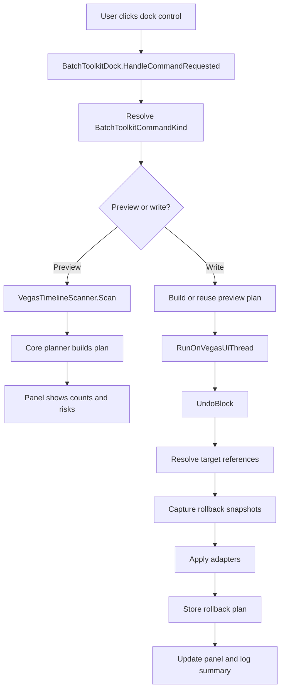
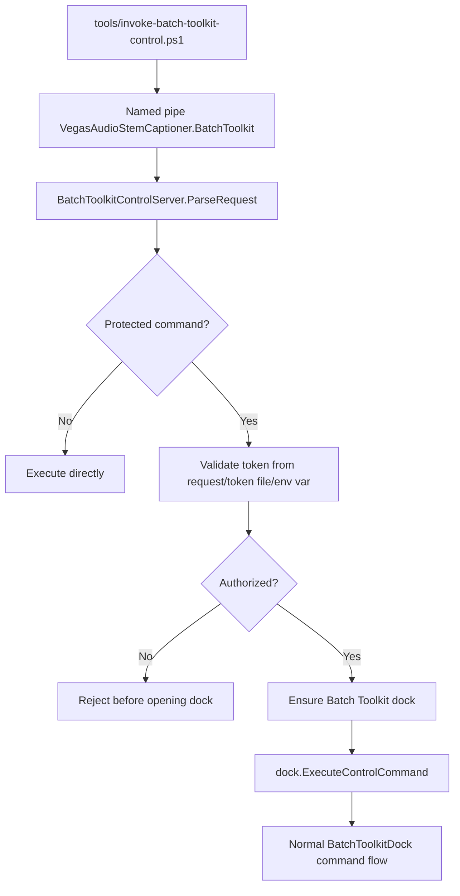
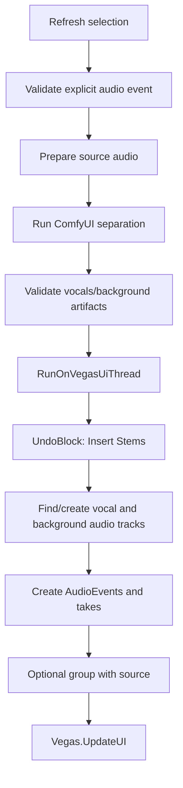
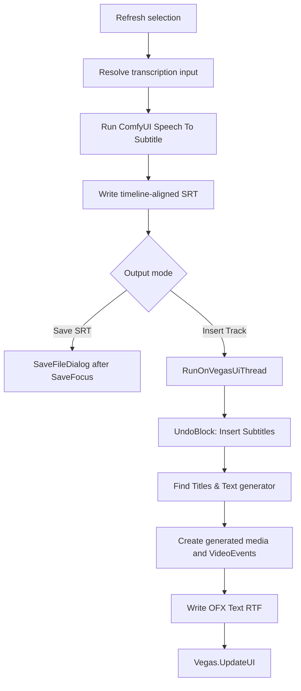
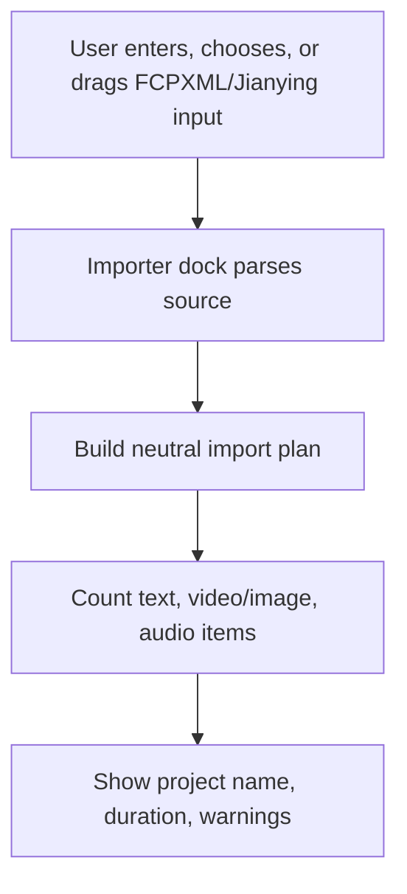
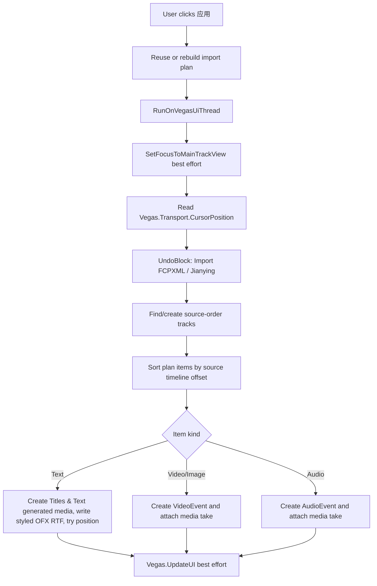

# VEGAS Pro API And Call Flow

This document records the VEGAS Pro `ScriptPortal.Vegas` API surface used by this workspace and the required call flow for safe timeline reads and writes.

Source material:

- `VEGASScriptAPI.md`
- `docs/vegas-extension-window-constraints.md`
- `docs/vegas-audio-track-interaction.md`
- `docs/vegas-batch-toolkit-architecture-ui.md`
- `docs/vegas-extension-install-and-diagnostics.md`
- current implementation under `src/VegasAudioStemCaptioner`
- current implementation in the separate repository `https://github.com/dazhn/VegasFcpxmlImporter`

## Product Boundary

There are two separate VEGAS-facing extension products in this workspace. They share `ScriptPortal.Vegas` host constraints, but they are not one application and should not share runtime state.

### Vegas Audio Stem Captioner

The active extension assembly is `VegasAudioStemCaptioner.dll`. It exposes two VEGAS Application Extension commands:

| Panel | CustomCommand name | Dock instance |
|---|---|---|
| Audio Stem & Captions | `Zhong.VegasAudioStemCaptioner.View` | `Zhong.VegasAudioStemCaptioner.Dock` |
| Vegas Batch Toolkit | `Zhong.VegasBatchToolkit.View` | `Zhong.VegasBatchToolkit.Dock` |

Both commands are loaded through `ICustomCommandModule` and appear under `View > Extensions`.

### VEGAS FCPXML Importer

`VegasFcpxmlImporter` is a separate VEGAS Pro Application Extension maintained in `https://github.com/dazhn/VegasFcpxmlImporter`. It is not the Draft Agent Avalonia app, and it is not the Audio Stem & Captions / Batch Toolkit extension. Its assembly name currently remains `DraftAgent.VegasFcpxmlImporter.dll` because Draft Agent is one expected upstream exporter, but the extension's runtime boundary is VEGAS Pro import.

| Panel | CustomCommand name | Dock instance |
|---|---|---|
| FCPXML / Jianying Importer | `DraftAgent.VegasFcpxmlImporter.Tools` | `DraftAgent.VegasFcpxmlImporter.Dock` |

This command uses `CommandCategory.Tools`, so it belongs under the VEGAS Tools / tool-extension command category, not the `View > Extensions` category used by dock-only view panels.

Current importer direction:

- Parse FCPXML in the style of `reuelk/pipeline`: treat FCPXML as structured XML, read resources/projects/sequences/clips/captions, and normalize rational time into an import plan. Pipeline Neo's public direction includes FCPXML 1.5-1.14 DTD validation; this extension currently does field-level parsing and does not implement DTD validation.
- Parse Jianying 5.9-style draft directories in the style of `GuanYixuan/pyJianYingDraft`: read `draft_content.json`, `materials.videos/audios/texts`, `tracks[].segments[]`, text, media paths, `target_timerange`, and `source_timerange` into the same import plan. Fields that cannot map to plain VEGAS text/image/audio events are not consumed.
- Create VEGAS tracks and events inside the dock/plugin path, reusing the host-safe write rules in this document.

Hard boundary: do not confuse this extension with Draft Agent's main app. Draft Agent may export FCPXML or Jianying draft files; `VegasFcpxmlImporter` imports those external project descriptions inside VEGAS. It must not read `InteractionProject`, `WorkbenchDocument`, Draft Agent project JSON, or Avalonia UI state directly.

## Goal

The goal of this document is to be the single active reference for VEGAS Pro API usage in this project: which `ScriptPortal.Vegas` APIs are used, where they are called, what order they must be called in, and which host-specific constraints must be preserved when changing the extension.

## Current Direction

Current development focuses on keeping VEGAS timeline operations stable in three active areas:

- Audio Stem & Captions: selection reading, source audio export, stem insertion, SRT output, and generated subtitle insertion.
- Vegas Batch Toolkit: Preview/Apply planning, template sync, Text IO, Event FX, Pan/Crop, Event Properties, smoke tests, and rollback.
- VEGAS FCPXML Importer: FCPXML/Jianying draft parsing, read-only preview, current-cursor import, generated text events, image events, audio events, and source-offset preservation.

Retired or non-active areas such as caption-marker command APIs, non-event FX expansion, broadcast caption research, and direct external-process VEGAS writes are not part of the current API direction.

## API Requirements

- Extension startup must remain lightweight.
- Read flows must tolerate VEGAS COM property failures and produce diagnostics.
- Preview flows must be read-only.
- Write flows must run on the dock/plugin path, on the VEGAS UI context, inside a command-level `UndoBlock`.
- Target writes must capture rollback state before mutation.
- Destructive FX writes must resolve plug-ins by stable ID.
- Text IO must use ordinary project `Markers` and `Regions`.
- Host-specific VEGAS Pro 19 limitations must stay visible in active docs and code comments/logging.

## Extension Lifecycle APIs

| API | Current use | Notes |
|---|---|---|
| `ICustomCommandModule.InitializeModule(Vegas vegas)` | Entry point for extension initialization. | Must stay lightweight; no project scan, plug-in enumeration, or large config load during startup. |
| `ICustomCommandModule.GetCustomCommands()` | Returns extension panel commands. | Returns `CustomCommand` instances created during initialization. Audio Stem Captioner returns two commands; FCPXML Importer returns one. |
| `CustomCommand` | Creates menu/toolbar/keybinding-capable extension commands. | `Name` must remain stable so VEGAS can preserve menu, toolbar, shortcut, and dock state. |
| `CustomCommand.Invoked` | Opens or activates the dock. | Calls the panel-specific dock show path. |
| `CustomCommand.MenuPopup` | Updates `command.Checked`. | Checked when the dock object exists and is not disposed. |
| `DockableControl` | Base class for both panels. | It is a `UserControl`, not a normal `Form`; VEGAS owns the outer window. |
| `Vegas.LoadDockView(IDockView)` | Registers a dock instance. | Called once per dock object before activation. |
| `Vegas.ActivateDockView(instanceName)` | Shows or focuses the dock. | Uses the stable dock instance name. |
| `DockableControl.AutoLoadCommand` | Associates dock with command. | Used so VEGAS can restore dock state. |
| `DockableControl.DisplayName` | Visible dock title. | User-facing panel name. |
| `DockableControl.DefaultFloatingSize` | First floating size. | Does not guarantee docked size. |
| `DockableControl.PersistDockWindowState` | Persists dock layout. | Enabled for the panels. |
| `DockableControl.SaveFocus()` | Used before modal dialogs. | Current save-SRT path calls it before `SaveFileDialog`. |
| `DockableControl.SetFocusToMainTrackView()` | Best-effort focus before timeline writes. | Failure is logged and does not block the operation. |

## Threading Rule

All VEGAS object reads and writes that touch the project should run on the dock/UI thread.

Current pattern:

1. Background work is allowed for external systems such as ComfyUI HTTP jobs, file IO, and JSON parsing.
2. Before mutating the VEGAS timeline, call a dock helper that uses the WinForms control:

```csharp
if (!control.InvokeRequired)
{
    SetFocusToMainTrackView();
    return action();
}

return (T)control.Invoke(new Func<T>(() =>
{
    SetFocusToMainTrackView();
    return action();
}));
```

3. Wrap each write operation in one command-level `UndoBlock`.

## Undo And Recovery APIs

| API | Use | Required behavior |
|---|---|---|
| `new UndoBlock(project, name)` | Groups one user-visible timeline write operation. | Use one command-level block per Apply/Insert/Create/Delete operation. |
| `Vegas.UpdateUI()` | Refreshes VEGAS UI after timeline mutation. | Best-effort; log failures. |
| Plugin rollback snapshots | Restores target state when host Undo is incomplete or a per-target write fails. | Capture before write and restore inside the same command when possible. |

Do not use scripted `Project.Undo()` in the default smoke path. VEGAS Pro 19 showed redo-buffer host errors. Real host Ctrl+Z is validated through the manual undo probe, while default smoke uses explicit rollback verification.

## Timeline Read APIs

### Project Scan

| API | Use |
|---|---|
| `Vegas.Project.Tracks` | Enumerate all tracks. |
| `Track.Events` | Enumerate events on each track. |
| `Track.Index`, `Track.DisplayIndex`, `Track.Name`, `Track.MediaType`, `Track.Selected` | Build track models and diagnostics. |
| `TrackEvent.Index`, `TrackEvent.Name`, `TrackEvent.Start`, `TrackEvent.Length`, `TrackEvent.End` | Build stable-ish event models and references. |
| `TrackEvent.Selected`, `TrackEvent.Locked`, `TrackEvent.Mute`, `TrackEvent.Loop`, `TrackEvent.PlaybackRate` | Read selection and event properties. |
| `TrackEvent.IsAudio()`, `TrackEvent.IsVideo()`, `TrackEvent.MediaType` | Classify events, with casts as fallback. |
| `TrackEvent.ActiveTake` | Read source media, generated media, and take metadata. |
| `Take.MediaPath`, `Take.Offset`, `Take.Name`, `Take.Media` | Resolve source file, source slice, generated media, and event identity. |
| `Vegas.Transport.CursorPosition`, `SelectionStart`, `SelectionLength` | Read cursor and timeline selection. |
| Legacy `Vegas.Cursor`, `Vegas.SelectionStart`, `Vegas.SelectionLength` | Fallback when `Transport` read fails. |

The FCPXML Importer only reads the VEGAS cursor before import. Its source timeline reads come from external FCPXML/Jianying files, not from the current VEGAS project.

### Audio Selection Resolution

The Audio Stem & Captions panel resolves selected audio in this order:

1. Enumerate `Project.Tracks`.
2. Enumerate each `Track.Events`.
3. Prefer selected `AudioEvent` candidates.
4. If a selected `VideoEvent` exists, try related audio through:
   - `TrackEvent.SyncEvent`;
   - grouped events through `TrackEvent.Group`;
   - same media path, start, and length lookup.
5. If no event is selected but an audio track is selected, use cursor or timeline selection to find a usable audio event.
6. Return a `VegasSelectionSnapshot` with diagnostics when no audio is found.

The reader uses safe wrappers around most VEGAS property reads because host COM calls can throw.

## Audio Export APIs

| API | Use |
|---|---|
| `TrackEvent.ActiveTake` | Required for source media and take offset. |
| `Take.MediaPath` | Direct source file path when usable. |
| `Take.Offset` | Source offset for selected event slice. |
| `Take.GetAudioAsFile(streamIndex, offset, length, outputPath)` | Exports selected event audio when direct source file is not safe. |

Call flow:

1. Validate selected `AudioEvent`.
2. Read its active `Take`.
3. If direct source is allowed, pass `Take.MediaPath` to the engine.
4. Otherwise create a job output path and call `take.GetAudioAsFile(0, take.Offset, sourceEvent.Length, outputPath)`.
5. Verify the output file exists.
6. Treat export failure as a hard failure before calling ComfyUI.

`TrackEvent.Loop` alone is not treated as requiring export; many normal VEGAS media events report loop enabled.

## Track Creation APIs

| API | Use | Preference |
|---|---|---|
| `new AudioTrack(project, index, null)` + `Project.Tracks.Add(track)` | Create audio tracks. | Preferred. |
| `new VideoTrack(project, index, null)` + `Project.Tracks.Add(track)` | Create video tracks. | Preferred. |
| `Project.AddAudioTrack()` | Fallback audio track creation. | Use only if constructor path fails. |
| `Project.AddVideoTrack()` | Fallback video track creation. | Use only if constructor path fails. |
| `Track.Name` | Best-effort display name. | Do not depend on rename success. |
| `Track.Selected` | Best-effort track selection restore. | Safe to attempt; log failure. |

Required flow:

1. Reuse a matching named track when possible.
2. For audio stems, also reuse an empty nearby audio track when it is not the source track.
3. For subtitles, prefer selected video track or an empty reusable video track before creating a new one.
4. When creation is required, try constructor path first, then automatic-index constructor, then `Project.Add*Track`.
5. Set track name as best-effort.
6. Do not rely on track name as a stable identity.

Known VEGAS Pro 19 issue: `IProjectCOM.AddTrack` / `Project.AddVideoTrack()` and `Track.Name` writes can return `E_UNEXPECTED`.

## Event Creation APIs

### Audio Event From File

| API | Use |
|---|---|
| `Media.CreateInstance(project, mediaPath)` | Load audio file into project media. |
| `Media.GetAudioStreamByIndex(0)` | Get audio stream for take insertion. |
| `new AudioEvent(project, start, length, name)` | Construct timeline event. |
| `Track.Events.Add(trackEvent)` | Add event to target track. |
| `TrackEvent.AddTake(stream, true, takeName)` | Attach media stream as take. |
| `TrackEvent.ActiveTake.Offset` | Apply FCPXML `asset-clip start` as source media offset. |
| `TrackEvent.Loop` | Best-effort set to `false`. |

Required flow:

1. Validate file exists and is non-empty.
2. Create `Media`.
3. Read audio stream.
4. Construct `AudioEvent`.
5. Add event to target track.
6. Add take.
7. Apply `ActiveTake.Offset` from FCPXML source `start` when non-zero.
8. Set take name and `Loop=false` as best-effort.
9. Verify `Start` and `Length`.
10. If take add or verification fails, remove the event from the track.

The FCPXML Importer follows the same media-event order. It validates the file path, creates `Media`, reads stream index 0, creates the event, adds it to the reused/created track, attaches the take, applies source offset, and removes the event if take insertion fails.

### Video/Image Event From File

| API | Use |
|---|---|
| `Media.CreateInstance(project, mediaPath)` | Load image or video file into project media. |
| `Media.GetVideoStreamByIndex(0)` | Get video stream for take insertion. |
| `new VideoEvent(project, start, length, name)` | Construct timeline event. |
| `Track.Events.Add(trackEvent)` | Add event to target track. |
| `TrackEvent.AddTake(stream, true, takeName)` | Attach media stream as take. |
| `TrackEvent.ActiveTake.Offset` | Apply source media offset from FCPXML/Jianying source range. |
| `TrackEvent.Loop` | Best-effort set to `false`. |
| `VideoEvent.MaintainAspectRatio` | Best-effort preserve image aspect ratio. |
| `VideoEvent.ReduceInterlace` | Best-effort disable interlace reduction for still/project media. |

Required flow:

1. Validate file exists and is non-empty.
2. Create `Media`.
3. Read video stream.
4. Construct `VideoEvent`.
5. Add event to target track.
6. Add take.
7. Apply source offset when non-zero.
8. Set `Loop=false`, `MaintainAspectRatio=true`, and `ReduceInterlace=false` as best-effort.
9. If take add or stream lookup fails, remove the event from the track.

### Generated Text Event

| API | Use |
|---|---|
| `Vegas.Generators.FindChildByUniqueID(id)` | Find Titles & Text generator. |
| `Media.CreateInstance(project, generator)` | Create generated media. |
| `Media.Length` | Best-effort generated media length. |
| `Media.Generator` | Access generator effect. |
| `Media.GetVideoStreamByIndex(0)` | Get video stream for take insertion. |
| `new VideoEvent(project, start, length, name)` | Construct generated subtitle event. |
| `Track.Events.Add(trackEvent)` | Add event to target video track. |
| `TrackEvent.AddTake(stream, true, takeName)` | Attach generated media stream. |

Titles & Text unique IDs:

```text
{Svfx:com.vegascreativesoftware:titlesandtext}
{Svfx:com.sonycreativesoftware:titlesandtext}
```

Known VEGAS Pro 19 issue: `Media.Length` on generated media can return `E_UNEXPECTED`; the event length remains authoritative.

## Titles & Text APIs

| API | Use |
|---|---|
| `Media.IsGenerated()` | Identify generated media. |
| `Media.Generator` | Read generator effect. |
| `Effect.PlugIn.UniqueID` | Prefer stable generator identity. |
| `Effect.OFXEffect` | Access writable OFX parameters. |
| `OFXEffect["Text"]`, `["text"]`, `["Texts"]`, `["texts"]` | Read/write Titles & Text RTF content. |
| `OFXDouble2DParameter.Value` | Best-effort subtitle position write. |
| `Effect.CurrentPreset.Name` | Read current animation/preset name. |
| `Effect.Preset` | Best-effort set animation/preset name. |

Titles & Text detection:

1. Read the active take media.
2. Confirm `Media.IsGenerated()`.
3. Read `Media.Generator`.
4. Prefer known `PlugIn.UniqueID`.
5. Fallback: require OFX string parameter `Text`, `text`, `Texts`, or `texts`.

Text write flow:

1. Read current RTF from the text parameter.
2. Load it into `RichTextBox`.
3. Replace the visible text while applying selected font, selected font color, selected font size, and centered RTF alignment.
4. Write updated RTF back to `OFXStringParameter.Value`.
5. For `VegasFcpxmlImporter`, try to set the Titles & Text 2D position to `0.50, 0.10` through `Location`, `Position`, or `Placement` parameter aliases; missing parameters are logged and do not block import.
6. For `VegasFcpxmlImporter`, try to set outline/stroke/border options through common OFX parameter aliases: boolean enable, width double, and RGB/RGBA color. Missing parameters are logged and do not block import.
7. For subtitle insertion, verify by loading the written RTF and comparing plain text where the caller implements verification.

## OFX Parameter APIs

| Parameter type | API |
|---|---|
| Boolean | `OFXBooleanParameter.Value` |
| Double | `OFXDoubleParameter.Value`, `Min`, `Max`, `DisplayMin`, `DisplayMax` |
| Integer | `OFXIntegerParameter.Value`, `Min`, `Max`, `DisplayMin`, `DisplayMax` |
| Double2D | `OFXDouble2DParameter.Value.X/Y` |
| Choice | `OFXChoiceParameter.Value`, `Choices[]` |
| RGB/RGBA | `OFXRGBParameter.Value`, `OFXRGBAParameter.Value`, `OFXColor` |
| String | `OFXStringParameter.Value` |
| Parameter lookup | `OFXEffect.FindParameterByName(name)` then `OFXEffect[name]` fallback |
| Parameter enumeration | `OFXEffect.Parameters` |

Rules:

- Clamp numeric writes to parameter min/max when available.
- Match choices by normalized name; fallback only where explicitly designed.
- Serialize colors as hex for snapshots.
- Snapshot both parameter values and metadata before Event FX writes.
- Log missing or unsupported parameters; do not silently pretend a full style/FX copy succeeded.

## Event FX APIs

| API | Use |
|---|---|
| `VideoEvent.Effects` | Read and write Event FX chain. |
| `Effects.AddEffect(PlugInNode)` | Add an FX plug-in instance. |
| `Effects.Clear()` | Replace mode clears chain after preflight. |
| `Effects.RemoveAt(index)` | Remove matching FX instances. |
| `Effect.PlugIn.UniqueID` | Stable plugin matching. |
| `Effect.PlugIn.Name` | Display name only. |
| `Effect.CurrentPreset.Name` | Snapshot preset. |
| `Effect.Preset` | Best-effort set preset. |
| `Effect.Bypass` | Enable/bypass effect. |
| `Effect.ApplyBeforePanCrop` | Snapshot and restore order behavior. |
| `Effect.OFXEffect` | Snapshot/copy parameter values. |
| `Vegas.VideoFX` | Root plug-in tree for resolving video FX plug-ins by stable ID. |

Event FX write modes:

| Mode | Flow |
|---|---|
| Replace | Resolve every template plug-in by stable ID, then clear target chain, add resolved effects, apply preset/bypass/parameters. |
| Append | Resolve every template plug-in, preserve existing target chain, append new effects. |
| MergeByPluginId | Resolve every template plug-in, update first matching target effect by stable ID, append missing effects. |
| Copy Parameters | For each template effect with stable ID, find matching target effect and copy preset/OFX parameters. |
| Remove Matching | Remove target effects whose stable plugin IDs match template stable IDs. |
| Bypass/Enable | Set `Effect.Bypass` across target Event FX. |

Hard rule: destructive or matching writes must use stable plug-in IDs, never display names.

## Pan/Crop APIs

| API | Use |
|---|---|
| `VideoEvent.VideoMotion` | Access Pan/Crop data. |
| `VideoMotion.ScaleToFill` | Snapshot/apply scale-to-fill. |
| `VideoMotion.Keyframes` | Read, clear, and rebuild keyframes. |
| `VideoMotionKeyframe.Position` | Keyframe time. |
| `VideoMotionKeyframe.Bounds` | Crop geometry. |
| `VideoMotionKeyframe.Center` | Center point. |
| `VideoMotionKeyframe.Rotation` | Rotation. |
| `VideoMotionKeyframe.Type` | Interpolation. |
| `new VideoMotionKeyframe(project, timecode)` | Create keyframes. |
| `VideoMotionBounds` and `VideoMotionVertex` | Rebuild geometry. |

Write flow:

1. Read current snapshot for rollback.
2. Merge template/layout snapshot according to keyframe strategy.
3. Refuse to write an empty Pan/Crop snapshot.
4. Resolve current `Project`.
5. Set `ScaleToFill`.
6. Clear keyframes.
7. Recreate keyframes from snapshot.
8. Restore interpolation when parseable.

## Event Property APIs

| API | Use |
|---|---|
| `TrackEvent.Start` | Move event. |
| `TrackEvent.Length` | Change event length. |
| `TrackEvent.PlaybackRate` | Change playback speed. |
| `TrackEvent.FadeIn.Length`, `FadeOut.Length` | Copy fades. |
| `TrackEvent.Loop` | Copy loop flag when selected. |
| `TrackEvent.Mute` | Copy muted state. |
| `TrackEvent.Locked` | Copy/restore locked state. |
| `VideoEvent.ResampleMode` | Video event resample behavior. |
| `VideoEvent.MaintainAspectRatio` | Video aspect behavior. |
| `VideoEvent.ReduceInterlace` | Reduce interlace flicker. |

Batch property writes are patch-based. Only enabled fields are written. Rollback restore writes the full captured state.

## Markers And Regions APIs

| API | Use |
|---|---|
| `Vegas.Project.Markers` | Read, add, remove ordinary project markers. |
| `Vegas.Project.Regions` | Read, add, remove ordinary project regions. |
| `new Marker(start, label)` | Create marker. |
| `new ScriptPortal.Vegas.Region(start, length, label)` | Create region. |
| `BaseList<Marker>.Remove(marker)` | Remove marker. |
| `BaseList<Region>.Remove(region)` | Remove region. |

Text IO rules:

- Use ordinary project `Markers` and `Regions` only.
- Do not implement caption-marker command APIs.
- Preview must be read-only.
- Create/delete writes must run in a command-level `UndoBlock`.
- Empty-filter marker deletion is refused until explicitly allowed.
- Duplicate policies must recheck existing project markers/regions at execution time.

## Batch Toolkit Call Flow

### UI Command Flow



### Control Pipe Flow



Protected write commands include `pick-template`, `apply`, `apply-text-tools`, `apply-video-placement`, `apply-pancrop-layout`, `apply-event-fx`, subtitle import/export, marker create/delete, rollback, smoke test, and preset save/load commands.

## Audio Stem & Captions Call Flow

### Separate



### Transcribe And Output



## FCPXML Importer Call Flow

### Preview



Select/drag parsing is read-only. `选择` only opens a file picker, fills the path, and parses after selection; parsing errors are written to the dock log list and local log instead of shown as modal error dialogs. Drag-drop fills the path and parses immediately. This flow must not enter `UndoBlock`, create tracks, load media into VEGAS, change selection, or move the cursor.

### Import



Current track names:

The importer reuses existing same-name tracks for Jianying. When it must create tracks, it appends them in source order: Jianying preserves `tracks[]` order, names, and empty tracks; FCPXML creates unnamed tracks in lane order, keeps missing positive lanes as empty placeholders, and leaves extra lanes unnamed. Audio/text/video tracks must not be reordered into a fixed plug-in category order.

| Import item | Track name | Notes |
|---|---|---|
| Text/caption | FCPXML unnamed lane track; Jianying source track name, for example `字幕` | Uses Titles & Text generated media. |
| Video/image | FCPXML unnamed lane track; Jianying source track name | FCPXML video item or Jianying video track. |
| Audio | FCPXML unnamed lane track; Jianying source track name, for example `Character Dialogue` / `Character Inner Action` / `Narration Scene Effect` | FCPXML audio asset or Jianying audio segment. |

Parser contract:

- FCPXML parsing reads `resources/asset/media-rep` local file URIs, `asset-clip`, `caption`, `offset`, `duration`, `start`, and parent story/gap offsets.
- FCPXML parsing reads and reports `fcpxml@version`, but version does not dispatch a separate parser. Current behavior is field compatibility, not full-version compatibility: FCPXML 1.5-1.14 files parse only where they use the fields above.
- FCPXML rational time such as `24024/24000s` must parse to seconds without culture-dependent decimal handling.
- Jianying 5.9 parsing reads a draft directory or `draft_content.json`, not Draft Agent project JSON. It reads root `name/duration/new_version/version`, `materials.videos/audios` ids and paths, `materials.texts` text content, `tracks[].type/name/segments`, `material_id`, `target_timerange.start/duration`, and `source_timerange.start`. Track order, names, and empty tracks are preserved from `tracks[]`; `render_index` is not used to reclassify video tracks.
- Jianying fields not consumed by this importer include `materials.speeds`, `extra_material_refs`, curve speed, transitions, effects, filters, animations, masks, stickers, color controls, keyframes, mix/volume curves, text styling, templates, and encrypted `draft_content.json`.
- Source media start ranges must become take offsets. Do not import every media segment from source time zero when the source format provides a trim start.
- Parser, file, drag-drop, and host write failures must be written to the dock log list and `%LOCALAPPDATA%\DraftAgent.VegasFcpxmlImporter\extension.log`.
- Subtitle options are applied at import time: font comes from the UI font selector, font color comes from the font color button, font size defaults to `12`, RTF alignment is centered, and position is fixed internally to `0.50, 0.10`. The UI intentionally does not expose position editing. Outline is disabled by default; when unchecked, width and color controls are disabled. When enabled, outline defaults to width `2.0` and black color.

## Stable References And Ambiguity Rules

Batch writes do not hold direct event objects across preview/apply boundaries as the only source of truth. They create `TimelineEventRef` values from:

- track index;
- event index;
- start/length/end nanos;
- event kind;
- generator ID;
- media path;
- active take name;
- track and event names.

Apply resolves exact position first. If exact lookup fails, it scans the current project and matches the fingerprint. If multiple events match, the write is refused. Rollback has a fallback resolver for cases where start/length/end changed during apply.

## Hard Constraints

- `InitializeModule` stays lightweight.
- `CustomCommand.Name` and `DockableControl` instance names stay stable.
- Preview commands do not mutate the VEGAS project and do not enter `UndoBlock`.
- Timeline writes run through the dock/plugin path, not directly from external processes.
- `VegasFcpxmlImporter` stays a separate VEGAS import extension; it must not call Draft Agent Avalonia app services or read Draft Agent workbench/project runtime state.
- External project parsers feed neutral import plans; only the VEGAS timeline importer layer may call `ScriptPortal.Vegas` write APIs.
- Write commands through the pipe require a local authorization token.
- One user operation uses one command-level `UndoBlock`.
- Per-target failures must restore captured target state inside the same command when possible.
- Event FX matching for destructive writes uses stable plug-in IDs.
- Text IO uses ordinary `Project.Markers` and `Project.Regions` only.
- Do not write `TrackEvent.Selected` during stem or subtitle insertion because VEGAS Pro 19 can fail `IEventCOM.SetSelected`.
- Do not depend on generated media length, track creation, or track rename as always reliable on VEGAS Pro 19.

## Known Host Risks

| Risk | Current mitigation |
|---|---|
| `Project.AddVideoTrack()` or lower COM `AddTrack` can fail with `E_UNEXPECTED`. | Prefer constructor plus `Project.Tracks.Add`, reuse existing/empty tracks, fallback to project method, log all attempts. |
| `Track.Name` write can fail. | Treat name as display-only and best-effort. |
| `Media.Length` on generated media can fail. | Use event length as authoritative. |
| `TrackEvent.Selected` writes can fail. | Avoid event selection mutation during insertion. |
| Scripted `Project.Undo()` can raise redo-buffer errors. | Default smoke skips scripted Undo and verifies explicit rollback; manual probe verifies host Ctrl+Z. |
| OFX parameter names differ across VEGAS versions. | Use known aliases, inspect parameters, log missing values. |
| Third-party OFX parameters may be readable but not safely writable. | Snapshot metadata, validate values, preflight plug-ins, fail target and restore snapshot on write failure. |

## Verification Commands

Local:

```powershell
dotnet build VegasAudioStemCaptioner.sln -v:minimal
tests\VegasAudioStemCaptioner.Tests\bin\Debug\net472\VegasAudioStemCaptioner.Tests.exe
tests\VegasAudioStemCaptioner.ExtensionTests\bin\Debug\net48\VegasAudioStemCaptioner.ExtensionTests.exe
```

Installed VEGAS:

```powershell
powershell -ExecutionPolicy Bypass -File tools\install-vegas-extension.ps1
powershell -ExecutionPolicy Bypass -File tools\invoke-batch-toolkit-control.ps1 -Command status -TimeoutSeconds 120
powershell -ExecutionPolicy Bypass -File tools\invoke-batch-toolkit-control.ps1 -Command smoke-test -TimeoutSeconds 240
powershell -ExecutionPolicy Bypass -File tools\invoke-batch-toolkit-control.ps1 -Command refresh -TimeoutSeconds 90
```

Log:

```text
%LOCALAPPDATA%\VegasAudioStemCaptioner\extension.log
```

FCPXML Importer:

```powershell
dotnet build .\VegasFcpxmlImporter.csproj -c Release -p:VegasInstallDir="C:\Program Files\VEGAS\VEGAS Pro 19.0"
```

`VegasFcpxmlImporter` no longer keeps a separate unit test project. Release verification is manual until a host smoke harness is added: install `DraftAgent.VegasFcpxmlImporter.dll` and its package dependencies, open it from the VEGAS Tools / tool-extension command category, load an FCPXML or Jianying draft without timeline changes, import at the current cursor, verify text/image/audio placement, verify source offsets, confirm missing media appears in the UI log, and confirm one host Undo reverses the import.

## Roadmap

1. Keep this guide synchronized with changes to VEGAS-facing code under `src/VegasAudioStemCaptioner`.
2. Keep this guide synchronized with changes to the separate `VegasFcpxmlImporter` repository, especially parser-to-importer call flow and any new `ScriptPortal.Vegas` write API.
3. Expand Jianying draft parsing beyond the current 5.9 plain media/text field contract when real target drafts require effects, transitions, curve speed, stickers, or encrypted draft handling.
4. When a new `ScriptPortal.Vegas` API is introduced, add it to the relevant API table and describe its call order and rollback behavior.
5. When real-VEGAS smoke tests expose a new host limitation, record the risk and mitigation here before relying on the behavior elsewhere.
